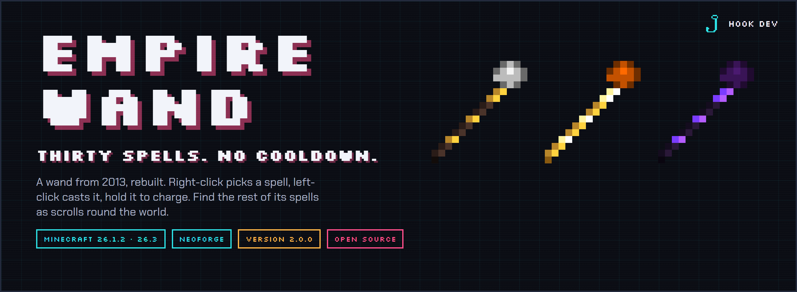
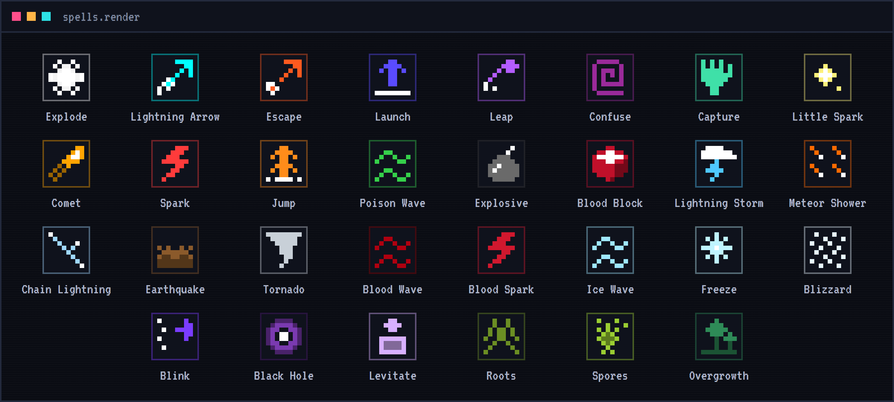
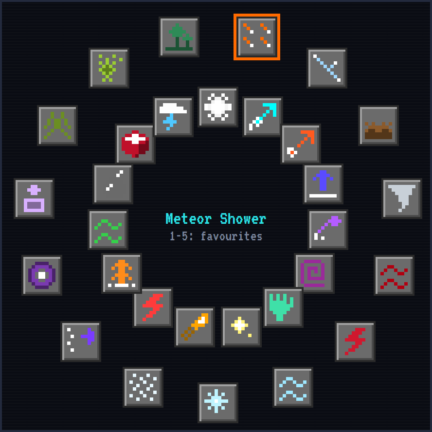
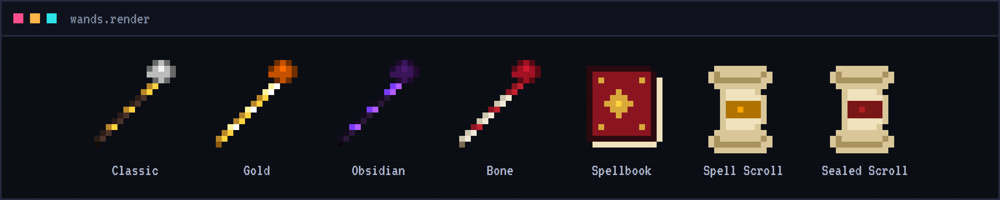

<p align="center">
  
</p>

<p align="center">
  <a href="https://github.com/ParadiseArchive/empire-wand/actions/workflows/build.yml"></a>
  
  
  
  <a href="LICENSE"></a>
</p>

<p align="center">
  <a href="https://github.com/ParadiseArchive/empire-wand/releases"><b>Releases</b></a> &nbsp;·&nbsp;
  <a href="https://hookdev.io/projects/minecraft-mods/"><b>More mods</b></a> &nbsp;·&nbsp;
  <a href="https://hookdev.io"><b>hookdev.io</b></a>
</p>

---

Empire Wand is a Minecraft mod about one wand and thirty spells. It started in 2013 as a Bukkit plugin for
Minecraft 1.7.2; now it is back, rebuilt for NeoForge, with every spell from back then and plenty of new ones.
There is no cooldown and no mana: spamming spells is the whole idea.

**One wand, thirty spells.** Right-click picks the next spell, left-click casts it. Hold left-click for a second and
the cast is charged: bigger, stronger, further. Every spell has its colour: the wand's crystal takes it on, and a beam
of sparks in that colour runs from its tip to wherever the spell lands.

## The heart of it: find your spells

A new Empire Wand knows four spells: Explode, Lightning Arrow, Escape and Launch. The other twenty-six are spell
scrolls, waiting round the world.

1. Craft an **Empire Wand**: a gold ingot, a blaze rod and a diamond, corner to corner.
2. Find **spell scrolls**: each place has its kind of spell. Ice in igloos and ancient cities, the void in strongholds
   and End cities, nature in jungle temples and mansions, lightning at pillager outposts, fire in the Nether. The heavy
   ones (Meteor Shower, Black Hole, Lightning Storm, Tornado, Earthquake) only turn up in hard places.
3. Right-click a scroll: the wand in your other hand learns its spell.

Scrolls also come from trial chamber vaults, suspicious sand and gravel, evokers, illusioners and witches; the Wither
and the Ender Dragon always leave one. A librarian sells a sealed scroll: break the seal and find out which spell it is.

<p align="center">
  
</p>

## The spell wheel

Press **R** with the wand in your hand: all its spells in two rings, each with its icon. Click one to pick it. Point at
a spell and press **1** to **5** to put it on that key; then a number key picks it straight away. Or sneak and scroll
to go through the spells you know.

<p align="center">
  
</p>

## What is in it

### The spells from 2013
Explode, Lightning Arrow, Escape, Launch, Leap, Confuse, Capture, Little Spark, Comet, Spark, Jump, Poison Wave,
Explosive, Blood Block and Lightning Storm: the reach, the power, the timings and the firework colours of the original
plugin. The fireworks burst right on the spot, as they did back then.

### New spells
Meteor Shower, Chain Lightning, Earthquake and Tornado; Blood Wave and Blood Spark; Ice Wave, Freeze and Blizzard;
Blink, Black Hole and Levitate; Roots, Spores and Overgrowth.

### Combos
Some spells work together. A blast near something frozen shatters it (**Shatter**). Chain Lightning while your Tornado
is going strikes everything inside it (**Storm**). Spores thrown into your Tornado make it poisonous (**Toxic Tornado**).

### The spellbook
A book, a blaze powder and a lapis: every spell, what it does, whether your wands know it, and where its scroll lies.

### Enchantments and skins
Enchant the wand at an enchanting table: **Power** (stronger), **Reach** (further), **Multicast** (sometimes twice).
Sneak and right-click with a gold block, obsidian or a bone block in your other hand for a gold, obsidian or bone
wand; a stick makes it classic again.



### The Dark Mage and the Wizard Tower
Somewhere in the plains, forests and taigas stands a Wizard Tower: three floors, a library at the top, a chest with three
scrolls (the heavy ones too) and two Dark Mages. A Dark Mage keeps his distance and throws your own spells at you:
Spark, Comet, Confuse, Launch and Freeze. Hit him and he may blink away. He often drops a scroll, and now and then
his obsidian wand.

### Advancements
From your first wand and your first scroll to Archmage (all thirty spells), Pyromaniac (a hundred blasts), Combo!,
Full Power, Mage Hunter and The End of Days (a Black Hole and a Tornado at the same time).

## Get it

Empire Wand **2.0.0** is on its way to CurseForge. Until then you can build it yourself (see below).

- Minecraft 26.3 or 26.1.2 with NeoForge, Java 25: pick the file for your Minecraft version
- Stand-alone: no other mod needed

## Building

```
./gradlew build               # jar for Minecraft 26.3 in build/libs
./gradlew build -Pmc=26.1     # jar for Minecraft 26.1.2 in build-26.1/libs
./gradlew runClient           # start a development client
./gradlew runGameTestServer   # run the automated in-game tests
```

Every push is built and tested by GitHub Actions. The textures, models, recipes and the Wizard Tower come from
`tools/gen-assets.mjs`; the pictures in this README from `tools/readme-art.mjs`.

## License

Copyright (c) 2026 Hook Development. Empire Wand is free software under the GNU General Public License v3.0 only, see
[LICENSE](LICENSE): you may use, change and share it, as long as what you share is under the same license, with its
source. Modpacks are welcome. The ideas and the spells are Hook Development's, from a plugin of 2013; the code and the
textures of this version are written with Claude, an AI assistant.
Minecraft names used in code come from Mojang's official mappings, see https://github.com/NeoForged/NeoForm/blob/main/Mojang.md.

<sub>NOT AN OFFICIAL MINECRAFT PRODUCT. NOT APPROVED BY OR ASSOCIATED WITH MOJANG OR MICROSOFT.</sub>

<p align="center"><a href="https://hookdev.io"><sub>made by Hook Development</sub></a></p>
