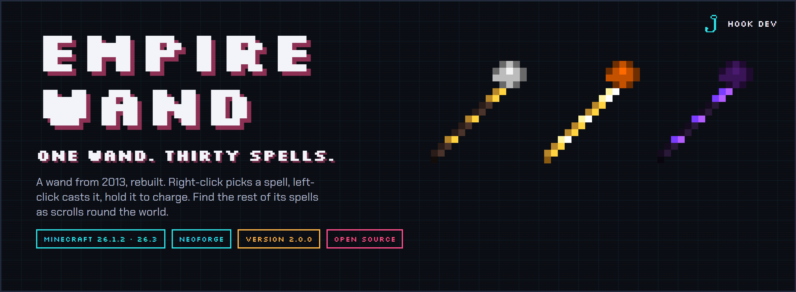
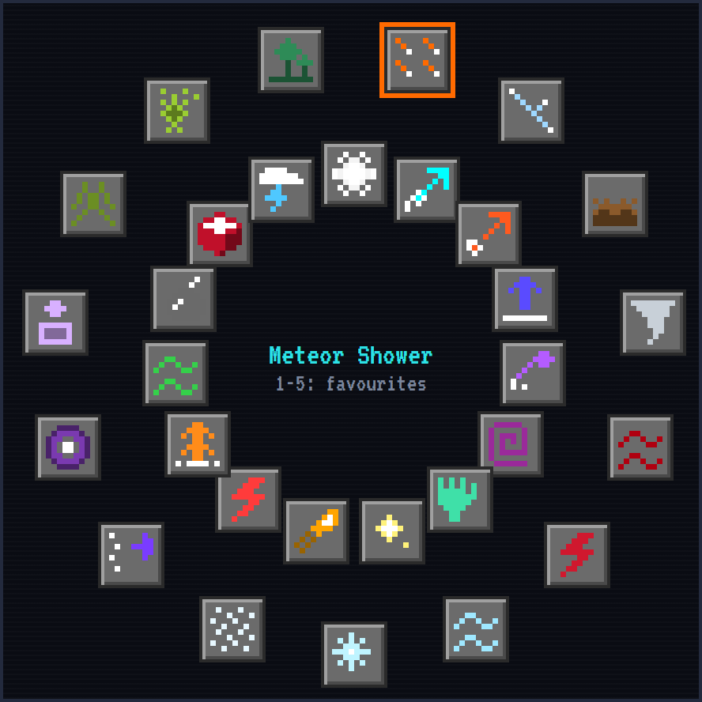
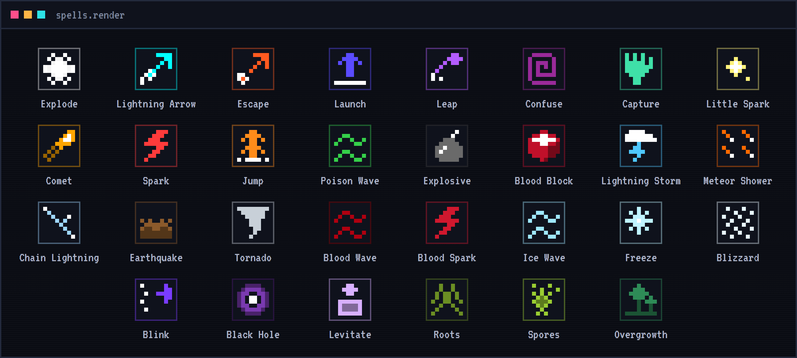
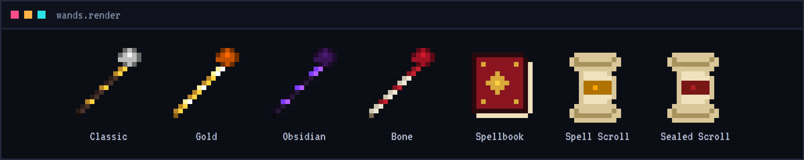

# Empire Wand

**One wand, thirty spells.**

Empire Wand started in 2013 as a Bukkit plugin for Minecraft 1.7.2. Now it is back, rebuilt for NeoForge, with every spell from back then and plenty of new ones. No mana: after each spell the wand cools down for a moment, from a second after a spark to fifteen after a black hole.

## How it works

- **Right-click** picks the next spell, **left-click** casts it.
- **Hold left-click** for a second: a charged cast, bigger, stronger and further.
- **A cooldown** after each spell (shown on the wand, as with ender pearls): short for the light spells, long for the heavy ones.
- **The spell wheel:** press R for all its spells in two rings; put your favourites on the keys 1 to 5, or sneak and scroll.
- Every spell has its colour: the wand's crystal takes it on, and a beam of sparks runs from its tip to where the spell lands.

## Find your spells

A new wand knows four spells. The other twenty-six are **spell scrolls** round the world, each place with its kind:

- **Ice** in igloos and ancient cities, **the void** in strongholds and End cities, **nature** in jungle temples and mansions, **lightning** at pillager outposts, **fire** in the Nether.
- **The heavy ones** (Meteor Shower, Black Hole, Lightning Storm, Tornado, Earthquake) only in hard places.
- Also in trial chamber vaults and suspicious sand and gravel, and from evokers, illusioners and witches. The Wither and the Ender Dragon always leave one.
- A librarian sells a **sealed scroll**: break the seal and find out which spell it is.
- Right-click a scroll and the wand in your other hand learns it.

## The spells

- **From 2013:** Explode, Lightning Arrow, Escape, Launch, Leap, Confuse, Capture, Little Spark, Comet, Spark, Jump, Poison Wave, Explosive, Blood Block, Lightning Storm. With the fireworks of the original plugin.
- **New:** Meteor Shower, Chain Lightning, Earthquake, Tornado, Blood Wave, Blood Spark, Ice Wave, Freeze, Blizzard, Blink, Black Hole, Levitate, Roots, Spores, Overgrowth.
- **Combos:** a blast near something frozen shatters it; Chain Lightning in your Tornado strikes all it holds; Spores make your Tornado poisonous.

## And more

- **The spellbook:** every spell, what it does, which you have, and where to find the rest.
- **Enchantments:** Power, Reach and Multicast, at the enchanting table.
- **Skins:** gold, obsidian or bone (sneak and right-click with the block in your other hand).
- **The Dark Mage and the Wizard Tower:** a tower with a library full of scrolls, guarded by mages who throw your own spells at you.
- **Advancements**, from your first scroll to Archmage.

## Good to know

- Minecraft 26.3 or 26.1.2 with NeoForge: pick the file for your Minecraft version.
- Stand-alone: no other mod needed.
- Open source (GPL-3.0): https://github.com/ParadiseArchive/empire-wand
- Made by Hook Development, with Claude, an AI assistant.
